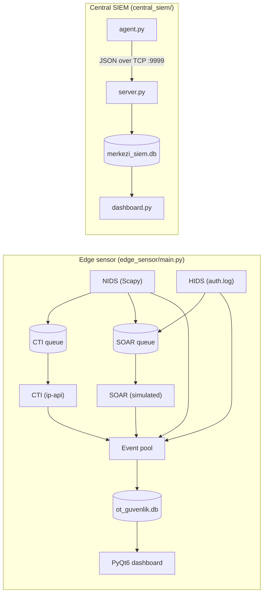

# OT Security XDR (MVP)

> A lightweight, open-source prototype of an **XDR / SIEM platform for industrial (OT) networks**: network IDS, host IDS, threat intelligence and automated response in one desktop app, plus a central SIEM that collects events from remote agents.


> ⚠️ **Prototype notice.** This is an educational MVP. The SOAR module _simulates_ containment (it does not modify firewall rules), the HIDS module reads a _simulated_ auth log, and the agent in `central_siem/` sends _scripted demo events_. Do **not** deploy it on a production network.

🇹🇷 Türkçe dokümantasyon: [README.tr.md](README.tr.md)

## Features

| Module                | What it does                                                                                                     |
| --------------------- | ---------------------------------------------------------------------------------------------------------------- |
| **NIDS**              | Sniffs live traffic with Scapy, flags access to sensitive ports (22, 23, 445, 3389) and detects DoS-like bursts. |
| **Adaptive baseline** | Learns normal per-IP packet rates for 10 s, then sets a dynamic threshold (mean + 3σ, min. 50 pkt/s).            |
| **HIDS**              | Tails a Linux `auth.log`-style file and raises alerts on failed SSH logins and privileged command use.           |
| **CTI**               | Enriches public attacker IPs with country / ISP via ip-api.com.                                                  |
| **SOAR (simulated)**  | Consumes threats from a queue and emits automatic "block IP / lock account" actions, de-duplicated per asset.    |
| **Dashboard**         | PyQt6 dark UI with live counters, colour-coded log table, filters and CSV forensic export.                       |
| **Central SIEM**      | TCP server + SQLite that aggregates JSON events from multiple agents, with its own live dashboard.               |

## Architecture



## Repository layout

```
edge_sensor/main.py       # All-in-one sensor + GUI (NIDS, HIDS, CTI, SOAR)
central_siem/server.py    # Multi-threaded TCP collector -> SQLite
central_siem/agent.py     # Demo agent that ships JSON events to the server
central_siem/dashboard.py # Central SIEM GUI
sample_data/              # Sample CSV report and simulated auth log
docs/screenshots/         # UI screenshots
```

## Quick start

```bash
git clone https://github.com/<erdemarr>/ot-security-xdr.git
cd ot-security-xdr
python -m venv .venv && source .venv/bin/activate   # Windows: .venv\Scripts\activate
pip install -r requirements.txt
```

**Edge sensor** (live sniffing needs elevated privileges: `sudo` on Linux/macOS, Administrator + [Npcap](https://npcap.com) on Windows):

```bash
cd edge_sensor
sudo python main.py
```

**Central SIEM demo** (three terminals, same working directory so they share `merkezi_siem.db`):

```bash
cd central_siem
python server.py      # 1) collector on :9999
python agent.py       # 2) demo agent
python dashboard.py   # 3) live dashboard
```

## Screenshots

Add your own images to `docs/screenshots/` and reference them here, for example:

```markdown


```

## Known limitations & roadmap

- [ ] Real SOAR actions (`iptables` / `netsh`) behind a dry-run flag and explicit confirmation
- [ ] Authentication / TLS and message framing for the agent-server channel (currently plaintext and unauthenticated)
- [ ] Real HIDS source (`/var/log/auth.log`) instead of simulated lines; tighten the `sudo` rule that also matches benign commands
- [ ] OT protocol awareness (Modbus/TCP, S7, DNP3); the sample report hints at the intended direction
- [ ] Shared package, config file, logging and unit tests; split `main.py` into modules
- [ ] HTTPS threat-intel provider with API key from an environment variable, plus caching
- [ ] Dashboard counter for `DoS Engellendi` events

## Disclaimer

For educational and research purposes only. Use only on networks you own or are authorised to monitor.

## License

MIT, see [LICENSE](LICENSE).
